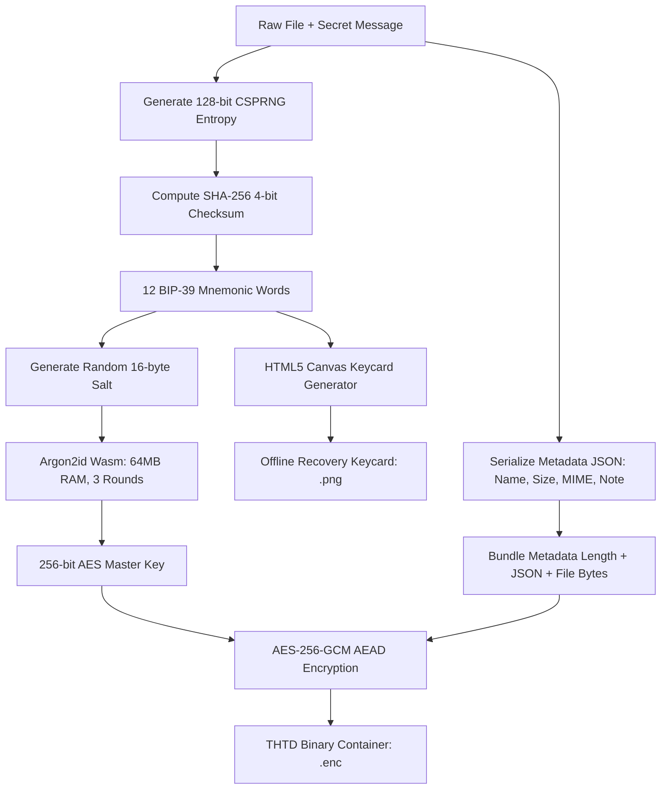

```
████████╗██╗  ██╗████████╗██████╗ 
╚══██╔══╝██║  ██║╚══██╔══╝██╔══██╗
   ██║   ███████║   ██║   ██║  ██║
   ██║   ██╔══██║   ██║   ██║  ██║
   ██║   ██║  ██║   ██║   ██████╔╝
   ╚═╝   ╚═╝  ╚═╝   ╚═╝   ╚═════╝ 
  TOO HARD TO DECRYPT // v2.4
```

<div align="center">

# THTD — Too Hard To Decrypt

**Zero-knowledge file vault secured by 12-word seed phrases, Argon2id, and AES-256.**

[](LICENSE)
[](docs/ARCHITECTURE.md)
[](docs/ARCHITECTURE.md)
[-purple?style=for-the-badge)](docs/ARCHITECTURE.md)
[-orange?style=for-the-badge)](docs/ARCHITECTURE.md)

[Features](#-key-features) • [How It Works](#-how-it-works) • [Mathematical Defense](#-mathematical-defense) • [Quick Start](#-quick-start) • [File Specification](#-binary-container-specification) • [Architecture](docs/ARCHITECTURE.md)

</div>

---

## ⚡ Overview

**THTD (Too Hard To Decrypt)** is an open-source, zero-knowledge, client-side cryptographic vault. It brings the intuitive recovery model of cryptocurrency hardware wallets (12 BIP-39 mnemonic seed words) to universal file encryption.

Every encryption derives a high-entropy 256-bit key through **Argon2id WebAssembly** with a unique 16-byte random salt, sealing the file and its metadata inside **AES-256-GCM**. The tool automatically produces both an encrypted container (`.enc`) and an offline **Recovery Keycard (`.png`)** equipped with brute-force resistance metrics.

---

## 🚀 Key Features

* **🔑 12-Word BIP-39 Mnemonic Seed:** Standard 128-bit CSPRNG entropy with a 4-bit SHA-256 checksum across 2,048 standardized words. No passwords to remember—just your seed phrase.
* **🛡️ Argon2id Memory-Hard KDF:** Enforces 64 MB RAM allocation and 3 iterations inside WebAssembly per derivation. Neutralizes GPU cracking rigs, ASIC miners, and botnet brute-force attempts.
* **🔒 AES-256-GCM Authenticated Encryption:** High-speed hardware-accelerated encryption via the native browser `crypto.subtle` API. Tamper-proof: changing even 1 bit of the ciphertext causes immediate cryptographic rejection.
* **🖼️ Auto-Generated Recovery Keycard (`.png`):** An HTML5 Canvas-rendered cryptographic keycard displaying the 12 numbered words, target file summary, brute-force resistance calculations, and security directives for cold offline storage.
* **📝 Encrypted Metadata Header:** Original file name, file size, MIME format, encryption timestamp, and an optional secret note are bundled and encrypted **inside** the ciphertext.
* **🌐 100% In-Browser & Zero-Knowledge:** Zero external network calls. No cookies, analytics, telemetry, or backend servers. Runs completely offline once loaded.
* **📱 Obsidian × Acid Lime Responsive UI:** Cyber-terminal aesthetic designed with modern CSS, glassmorphism, and responsive layouts optimized for mobile, tablet, and desktop screens.

---

## 🧠 Mathematical Defense

Can a hacker crack a THTD vault without the 12 words?

```
Keyspace Formula:
  2¹²⁸ = 340,282,366,920,938,463,463,374,607,431,768,211,456 combinations

Argon2id Cost per Guess:
  64 Megabytes of dedicated RAM + 3 sequential memory-hard hashing rounds

Hypothetical Attack Scenario:
  Combined compute of ALL supercomputers on Earth testing 1,000,000,000,000 (10¹²) hashes/second

Brute-Force Time:
  3.402 × 10³⁸ / (10¹² × 31,536,000 seconds/year) ≈ 1.078 × 10¹⁹ Years

Observable Universe Age:
  ~1.38 × 10¹⁰ Years (13.8 Billion Years)

Verdict:
  Cracking time is ~780,000,000× longer than the age of the Universe.
  Status: COMPUTATIONALLY IMPOSSIBLE.
```

---

## 🛠️ How It Works



---

## 📦 Binary Container Specification

THTD packages the encrypted file into a minimal, self-describing binary format:

| Byte Offset | Length | Type | Description |
|---|---|---|---|
| `0x00 - 0x03` | 4 Bytes | ASCII | Magic Header Identifier (`THTD`) |
| `0x04` | 1 Byte | `uint8` | Container Format Version (`0x01`) |
| `0x05 - 0x14` | 16 Bytes | Binary | Unique Random Salt (for Argon2id) |
| `0x15 - 0x20` | 12 Bytes | Binary | Initialization Vector / Nonce (for AES-GCM) |
| `0x21 - EOF` | Variable | Binary | AES-256-GCM Ciphertext + 16-byte Authentication Tag |

### Plaintext Payload Structure (Inside Ciphertext)
```
[ 4 Bytes: Big-Endian uint32 (Metadata JSON Length N) ]
[ N Bytes: UTF-8 Metadata JSON ]
[ Remaining Bytes: Original Raw File Payload ]
```

---

## 🏁 Quick Start

### 1. Run Locally (Zero Build Step)
Clone the repository and open `index.html` in any modern web browser:
```bash
git clone https://github.com/<your-username>/thtd.git
cd thtd
# Open directly in browser:
# Windows
start index.html
# macOS
open index.html
# Linux
xdg-open index.html
```

### 2. Host on GitHub Pages (1-Click)
1. Fork or push this repository to GitHub.
2. Go to **Settings** → **Pages**.
3. Under **Branch**, select `main` and root `/`.
4. Click **Save**. Your vault is live globally via GitHub Pages!

---

## 📁 Repository Structure

```
thtd/
├── index.html            # Core SPA interface (Encrypt / Decrypt / Specs)
├── style.css             # Obsidian × Acid Lime responsive theme
├── app.js                # Cryptographic engine & Canvas keycard generator
├── bip39-words.js        # 2,048-word standardized BIP-39 dictionary
├── lib/
│   └── argon2.umd.min.js # Standalone Argon2id WebAssembly engine (offline)
├── deploy/               # Production-ready export bundle
├── docs/
│   └── ARCHITECTURE.md   # Deep-dive cryptographic architecture document
├── LICENSE               # MIT License
└── README.md             # Project documentation
```

---

## 🛡️ Security & Threat Model

* **Memory Hygiene:** Mnemonic phrases and raw keys remain in volatile JavaScript heap memory only during the active tab session and are cleared upon reset.
* **Symmetric Nonce Security:** Every encryption generates a fresh 96-bit (12-byte) CSPRNG nonce via `window.crypto.getRandomValues()`.
* **Zero Telemetry:** No third-party tracking, cookies, external analytics, or remote API calls.
* **Integrity Guarantee:** Authenticated AES-GCM prevents bit-flipping attacks. Any unauthorized modification to the `.enc` container will fail authentication before decrypting.

---

## 📄 License

Distributed under the **MIT License**. See [`LICENSE`](LICENSE) for details.
