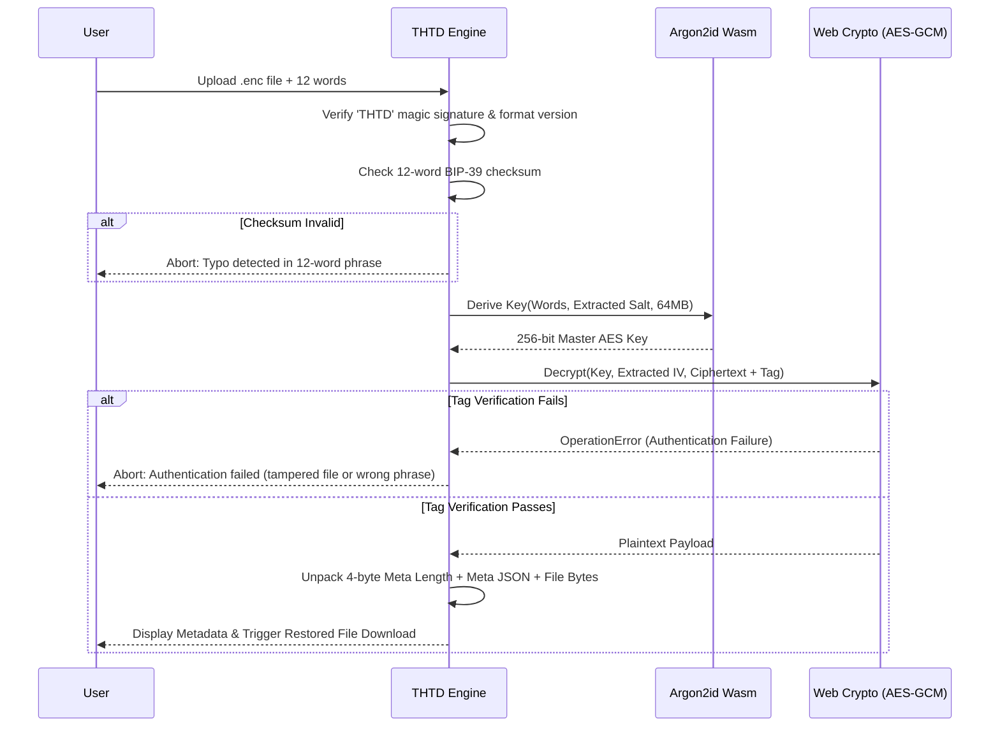

# THTD Technical Cryptographic Architecture & Specification

## Document Version: 2.4
**Classification:** Public Specification  
**System:** THTD (Too Hard To Decrypt)  
**Standard Compliance:** BIP-0039, RFC 9106 (Argon2), NIST SP 800-38D (AES-GCM), FIPS 180-4 (SHA-256)

---

## 1. Overview & Security Tenets

THTD is a zero-knowledge, client-side cryptographic storage system. It eliminates centralized key servers, accounts, passwords, and trusted third parties by implementing the mnemonic seed paradigm popularized by hierarchical deterministic (HD) cryptocurrency wallets.

### Fundamental Security Tenets
1. **Zero-Knowledge Architecture:** Cryptographic operations are executed exclusively within the user's browser runtime. Plaintext data, mnemonic phrases, and encryption keys are never transmitted over network boundaries.
2. **Memory-Hard Key Derivation:** Resistance against specialized Application-Specific Integrated Circuits (ASICs), Field Programmable Gate Arrays (FPGAs), and massive GPU password-cracking clusters is achieved via Argon2id.
3. **Authenticated Encryption with Associated Data (AEAD):** Confidentiality and data integrity are coupled through AES-256-GCM, preventing chosen-ciphertext attacks (CCA) and bit-flipping manipulation.
4. **Offline Durability:** Key material can be archived on physical media via an auto-generated visual keycard (`.png`).

---

## 2. Stage 1: Entropy Sourcing & BIP-39 Seed Generation

### 2.1 Cryptographic Randomness
Initial entropy $E$ of 128 bits (16 bytes) is acquired directly from the host operating system's kernel entropy pool using the W3C Web Cryptography API:

$$\mathbf{E} \leftarrow \text{crypto.getRandomValues}(\text{Uint8Array}(16))$$

This ensures compliance with NIST SP 800-90A/B guidelines for non-deterministic random bit generators.

### 2.2 Checksum Construction
To prevent silent user typos, a 4-bit checksum $C$ is computed from the SHA-256 hash of entropy $E$:

$$\mathbf{H} = \text{SHA-256}(\mathbf{E})$$

$$\mathbf{C} = \mathbf{H}_{[0..3]}$$

The 128-bit entropy is concatenated with the 4-bit checksum to yield a 132-bit sequence:

$$\mathbf{S}_{132} = \mathbf{E} \,\|\, \mathbf{C}$$

### 2.3 Mnemonic Word Mapping
The 132-bit sequence is partitioned into twelve 11-bit indices:

$$I_k = \mathbf{S}_{132}[11k \dots 11k + 10], \quad k \in \{0, 1, \dots, 11\}$$

Each index $I_k \in [0, 2047]$ references an entry in the standardized 2,048-word BIP-0039 English dictionary:

$$\mathbf{W}_k = \text{BIP39\_WORDLIST}[I_k]$$

$$\text{Mnemonic} = (\mathbf{W}_0, \mathbf{W}_1, \dots, \mathbf{W}_{11})$$

---

## 3. Stage 2: Memory-Hard Key Derivation (Argon2id)

### 3.1 Why Argon2id Over PBKDF2 or SHA-256
Standard password hashes (such as SHA-256 or MD5) can be evaluated billions of times per second on commodity GPUs. Even PBKDF2 with high iterations is memory-trivial, allowing massively parallelized GPU dictionary attacks.

Argon2id (RFC 9106) combines **Argon2d** (data-dependent memory access for maximum GPU resistance) and **Argon2i** (data-independent memory access for side-channel resistance).

### 3.2 Derivation Parameters
* **Password Input:** Normalized space-delimited string of the 12 words:  
  `P = "word1 word2 ... word12"`
* **Salt ($S$):** 16 bytes generated via CSPRNG per encryption session:  
  `S = crypto.getRandomValues(Uint8Array(16))`
* **Memory Cost ($m$):** $65,536 \text{ KiB}$ ($64 \text{ MB}$) allocated per derivation.
* **Time Cost ($t$):** $3 \text{ iterations}$ across memory blocks.
* **Parallelism ($p$):** $1 \text{ lane}$ (WebAssembly execution environment).
* **Output Length ($T_L$):** $32 \text{ bytes}$ ($256 \text{ bits}$).

$$\mathbf{K}_{\text{AES}} = \text{Argon2id}(P, S, t=3, m=65536, p=1, T_L=32)$$

---

## 4. Stage 3: Authenticated Encryption (AES-256-GCM)

### 4.1 Plaintext Payload Framing
Before encryption, metadata is serialized to UTF-8 JSON:

```json
{
  "fileName": "financial_report.pdf",
  "fileType": "application/pdf",
  "fileSize": 2490123,
  "timestamp": 1793345203878,
  "message": "Confidential internal document."
}
```

The plaintext payload is packaged contiguously:

```
+-----------------------------------+--------------------+------------------------+
| 4 Bytes (uint32 BE): Meta Length N| N Bytes: Meta JSON | Remaining: File Payload|
+-----------------------------------+--------------------+------------------------+
```

### 4.2 Galois/Counter Mode (GCM)
* **Cipher Key:** $\mathbf{K}_{\text{AES}}$ (256-bit derived from Argon2id).
* **Initialization Vector (IV):** 96-bit (12-byte) unique nonce per encryption:
  $$\mathbf{IV} \leftarrow \text{crypto.getRandomValues}(\text{Uint8Array}(12))$$
* **Authenticated Data:** The combined metadata and file payload are encrypted and signed simultaneously under Galois field $GF(2^{128})$ arithmetic:

$$(\mathbf{C}_{\text{data}}, \mathbf{T}_{\text{auth}}) = \text{AES-GCM-Encrypt}(\mathbf{K}_{\text{AES}}, \mathbf{IV}, \text{Payload})$$

Where $\mathbf{T}_{\text{auth}}$ is a 128-bit (16-byte) authentication tag appended to the ciphertext.

---

## 5. Binary Container Layout (`.enc`)

The generated `.enc` vault is structured as follows:

```
00 01 02 03 04 05 ... 20 21 ... 32 33 ... EOF
+-----------+----+-------+---------+------------------------------+
|   MAGIC   |VER | SALT  |   IV    | CIPHERTEXT + 16-BYTE GCM TAG |
|  'THTD'   |0x01| 16 B  |  12 B   |       Variable Length        |
+-----------+----+-------+---------+------------------------------+
```

* **Magic Bytes (Offset 0..3):** `0x54, 0x48, 0x54, 0x44` (ASCII `"THTD"`).
* **Version (Offset 4):** `0x01`.
* **Salt (Offset 5..20):** 16-byte CSPRNG salt passed to Argon2id upon decryption.
* **IV (Offset 21..32):** 12-byte AES-GCM nonce.
* **Ciphertext (Offset 33..EOF):** AES-GCM encrypted payload terminated with the 16-byte authentication tag.

---

## 6. Decryption Verification Pipeline

When a user provides a `.enc` file and 12 words:



---

## 7. Mathematical Attack Resistance Analysis

### 7.1 Exhaustive Keyspace Analysis
The total number of possible 12-word BIP-39 phrases is:

$$N = 2^{128} = 340,282,366,920,938,463,463,374,607,431,768,211,456$$

$$\approx 3.4028 \times 10^{38} \text{ combinations}$$

### 7.2 Hardware Feasibility
Because Argon2id requires **64 MB of RAM per hash instance**, an attacker cannot build parallel cracking pipelines with zero-memory latency.

* **Top-Tier Cracking Rig (8x RTX 4090 GPUs):** Maximum combined throughput for Argon2id ($m=65536, t=3$) is approximately $\approx 25,000 \text{ hashes/sec}$.
* **Hypothetical Global State-Level Supercomputer Cluster:** Assuming an adversary marshals global distributed infrastructure achieving **$1 \text{ Trillion } (10^{12}) \text{ guesses/sec}$**:

$$\text{Time} = \frac{3.4028 \times 10^{38} \text{ combinations}}{10^{12} \text{ guesses/sec} \times 31,536,000 \text{ sec/year}} \approx 1.0789 \times 10^{19} \text{ Years}$$

* **Age of the Universe:** $\approx 1.38 \times 10^{10} \text{ years}$.
* **Ratio:** $\approx 7.81 \times 10^8 \times \text{ Age of Universe}$.

---

## 8. Cold Offline Keycard Generation

To mitigate digital storage vulnerabilities (e.g., cloud sync, malware, disk failure), THTD renders an offline recovery keycard to an HTML5 Canvas and exports a lossless `.png`:

* **Visual Checksum Grid:** 12 numbered words in high-contrast Obsidian/Lime blocks.
* **Integrity Fingerprint:** Embedded target filename, file size, cipher configuration, and creation date.
* **Offline Storage Guidance:** Explicit instructions for paper printing or cold offline backup.
